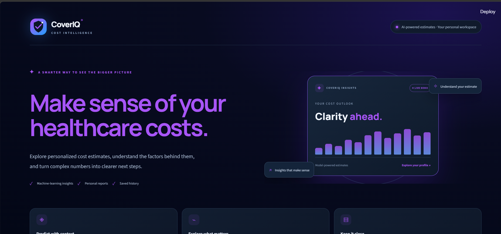
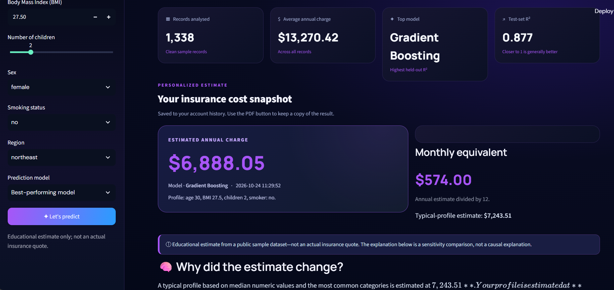
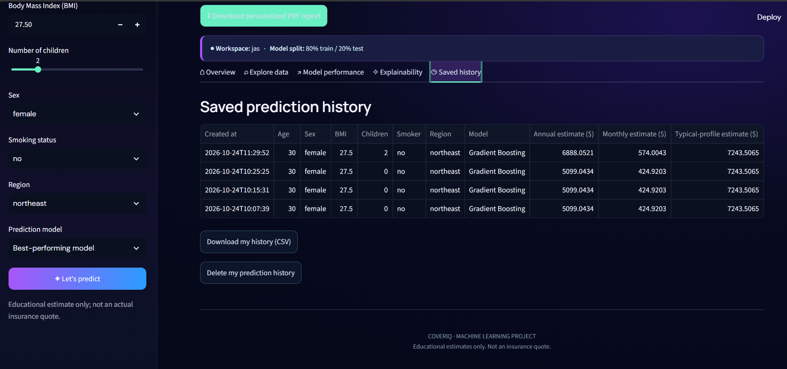

# 🛡️ CoverIQ — Insurance Cost Predictor

### Predict Medical Insurance Charges Using Machine Learning

CoverIQ is a machine learning web application that estimates individual medical insurance charges based on personal and lifestyle-related information. It provides an interactive interface for users to enter their details, receive estimated insurance costs, and explore model performance.

The project applies regression algorithms to predict insurance charges and compares model performance using standard evaluation metrics.

---

## 📌 Table of Contents

* [Overview](#-overview)
* [Objectives](#-objectives)
* [Features](#-features)
* [Technology Stack](#-technology-stack)
* [Machine Learning Models](#-machine-learning-models)
* [Model Evaluation](#-model-evaluation)
* [Application Screenshots](#-application-screenshots)
* [Project Structure](#-project-structure)
* [Installation and Setup](#️-installation-and-setup)
* [How to Use](#-how-to-use)
* [Dataset](#-dataset)
* [Future Enhancements](#-future-enhancements)
* [Disclaimer](#️-disclaimer)

---

## 📖 Overview

Medical insurance charges can vary depending on several factors, including age, body mass index (BMI), smoking habits, number of dependents, and geographical region.

CoverIQ uses machine learning to estimate medical insurance charges based on these input features.

The application provides an interactive interface for entering personal details and obtaining predictions. It also supports comparing regression models to understand their predictive performance.

**Project Type:** Machine Learning and Web Application
**Domain:** Healthcare Analytics and Insurance
**Application Framework:** Streamlit
**Problem Type:** Regression

---

## 🎯 Objectives

* Explore and preprocess a medical insurance cost dataset.
* Handle categorical features using appropriate encoding techniques.
* Apply feature scaling where required.
* Train and compare multiple machine learning regression models.
* Evaluate models using MAE, RMSE, and R².
* Perform five-fold cross-validation.
* Develop an interactive web application using Streamlit.
* Allow users to enter personal and lifestyle information and obtain estimated insurance charges.
* Present model evaluation results in an understandable format.

---

## ✨ Features

### 🏠 Interactive Home Page

A user-friendly landing page introducing CoverIQ and its purpose.

### 🔐 Login Interface

A login interface for accessing the application, if authentication is enabled.

### 💰 Insurance Cost Prediction

Enter relevant personal and lifestyle details to obtain a predicted medical insurance charge.

### 📊 Model Performance Comparison

Compare Linear Regression, Random Forest, and Gradient Boosting using regression evaluation metrics.

### 📈 Model Evaluation

Review MAE, RMSE, R², and five-fold cross-validation results to understand model performance.

### 🧾 Prediction History

Review previously saved predictions, if implemented in the application.

---

## 🛠️ Technology Stack

| Technology          | Purpose                               |
| ------------------- | ------------------------------------- |
| Python              | Main programming language             |
| Pandas              | Data manipulation and preprocessing   |
| NumPy               | Numerical computations                |
| Scikit-learn        | Machine learning and model evaluation |
| Streamlit           | Interactive web application           |
| Matplotlib / Plotly | Visualizations, where implemented     |
| Git                 | Version control                       |
| GitHub              | Source code hosting                   |

*The listed libraries should match the actual implementation and imports in the project.*

---

## 🤖 Machine Learning Models

CoverIQ compares the following regression algorithms.

### 1. Linear Regression

A baseline regression algorithm that models the relationship between input features and insurance charges.

**Purpose:** Establish a baseline for comparing prediction accuracy.

### 2. Random Forest Regressor

An ensemble learning algorithm that combines predictions from multiple decision trees to model complex relationships in the data.

**Purpose:** Capture nonlinear relationships between input features and insurance charges.

### 3. Gradient Boosting Regressor

An ensemble algorithm that builds decision trees sequentially, with each new tree helping reduce errors made by the existing model.

**Purpose:** Improve predictive performance by learning from previous model errors.

---

## 📊 Model Evaluation

The models are evaluated using the following metrics.

| Metric                  | Description                                                                                         |
| ----------------------- | --------------------------------------------------------------------------------------------------- |
| MAE                     | Mean Absolute Error; measures the average absolute difference between actual and predicted charges. |
| RMSE                    | Root Mean Squared Error; penalizes larger prediction errors more heavily.                           |
| R² Score                | Measures how well the model explains variation in the target values.                                |
| 5-Fold Cross-Validation | Evaluates model performance across five data folds to assess consistency.                           |

### Model Comparison Results

Replace the placeholders below with the actual results from your application.

| Model                       |        MAE |       RMSE |   R² Score | Mean 5-Fold CV R² |
| --------------------------- | ---------: | ---------: | ---------: | ----------------: |
| Linear Regression           | Add result | Add result | Add result |        Add result |
| Random Forest Regressor     | Add result | Add result | Add result |        Add result |
| Gradient Boosting Regressor | Add result | Add result | Add result |        Add result |

**Interpreting the results:**

* Lower MAE generally indicates smaller average prediction errors.
* Lower RMSE generally indicates smaller errors, with greater penalties for large errors.
* Higher R² generally indicates a better fit to the evaluation data.
* Cross-validation helps assess consistency across different data splits.

---

## 📸 Application Screenshots

Explore the CoverIQ interface and its key features through the screenshots below.

### 🏠 1. Home Page

The home page introduces CoverIQ and provides an entry point to the application's features.



### 🔐 2. Login Page

The login interface provides access to the application where authentication is implemented.


### 💰 3. Insurance Cost Prediction

The prediction interface allows users to enter relevant information and obtain an estimated insurance charge.



### 📊 4. Model Performance Comparison

The model performance interface presents evaluation results for comparing the implemented regression algorithms.



---

## 📂 Project Structure

```text
CoverIQ-Insurance-Cost-Predictor/
│
├── .streamlit/
│   └── config.toml
│
├── screenshots/
│
├── app.py
├── requirements.txt
├── README.md
├── .gitignore
│
├── home_page.png
├── login.png
├── prediction.png
└── model_performance.png
```

The four screenshot images above are referenced directly from the repository root. The `screenshots/` directory is also present in the repository and can be used to organize additional screenshots.

---

## ⚙️ Installation and Setup

Follow these steps to run CoverIQ locally.

### Prerequisites

Install the following:

* Python 3.10 or another version compatible with the project's dependencies.
* Git.
* A web browser.

### Step 1: Clone the Repository

```bash
git clone https://github.com/Avani376/CoverIQ-Insurance-Cost-Predictor.git
```

### Step 2: Navigate to the Project Folder

```bash
cd CoverIQ-Insurance-Cost-Predictor
```

### Step 3: Create a Virtual Environment

**Windows:**

```powershell
python -m venv venv
```

Activate the environment:

```powershell
.\venv\Scripts\Activate.ps1
```

If PowerShell blocks activation, use the virtual environment's Python executable directly to install dependencies.

### Step 4: Install Dependencies

```powershell
python -m pip install --upgrade pip
pip install -r requirements.txt
```

### Step 5: Run the Application

```powershell
streamlit run app.py
```

Streamlit will display a local URL, typically:

```text
http://localhost:8501
```

Open the URL in your browser to access CoverIQ.

---

## 🧭 How to Use

1. Clone the repository and install the required dependencies.
2. Start the Streamlit application.
3. Open the application in your browser.
4. Explore the home page.
5. Access the login interface if authentication is required.
6. Navigate to the insurance prediction section.
7. Enter the requested personal and lifestyle information.
8. Submit the inputs to generate an estimated insurance charge.
9. Visit the model performance section to compare the regression models.
10. Review prediction history if that feature is available.

---

## 📚 Dataset

This project is based on the **Medical Cost Personal Dataset**, commonly used for medical insurance cost prediction.

Typical features include:

| Feature    | Description                                      |
| ---------- | ------------------------------------------------ |
| `age`      | Age of the individual                            |
| `sex`      | Sex category                                     |
| `bmi`      | Body Mass Index                                  |
| `children` | Number of dependents                             |
| `smoker`   | Smoking status                                   |
| `region`   | Residential region                               |
| `charges`  | Medical insurance charges; the prediction target |

The dataset can be used to explore relationships between personal characteristics, lifestyle factors, and medical insurance charges.

**Dataset source:** Add the original dataset download reference used in the project.

---

## 🔮 Future Enhancements

* [ ] Deploy the application to Streamlit Community Cloud.
* [ ] Improve model performance through hyperparameter tuning.
* [ ] Add additional visualizations for model comparison.
* [ ] Enhance prediction explanations.
* [ ] Improve application accessibility and mobile responsiveness.
* [ ] Add secure authentication where required.
* [ ] Add persistent prediction storage where appropriate.
* [ ] Include actual model evaluation results in the README.

---

## ⚠️ Disclaimer

CoverIQ provides machine learning-based estimates for educational and demonstration purposes. Predictions are not official insurance quotations and should not be used as the sole basis for financial, medical, or insurance decisions.

Actual insurance charges may vary depending on insurer policies, coverage, location, underwriting criteria, and other factors.

---

## ⭐ Support

If you find this project interesting, consider giving the repository a star!

**Repository:** [Avani376/CoverIQ-Insurance-Cost-Predictor](https://github.com/Avani376/CoverIQ-Insurance-Cost-Predictor)

---

*CoverIQ — Exploring insurance cost prediction through machine learning.*
